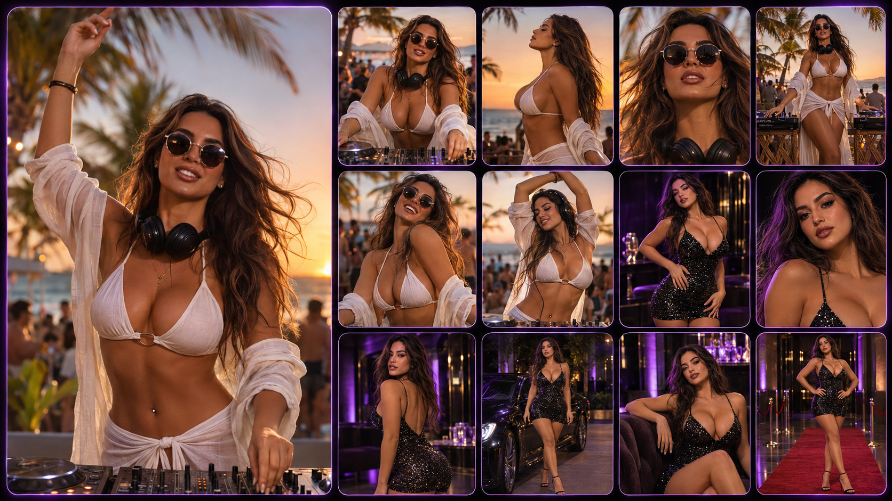
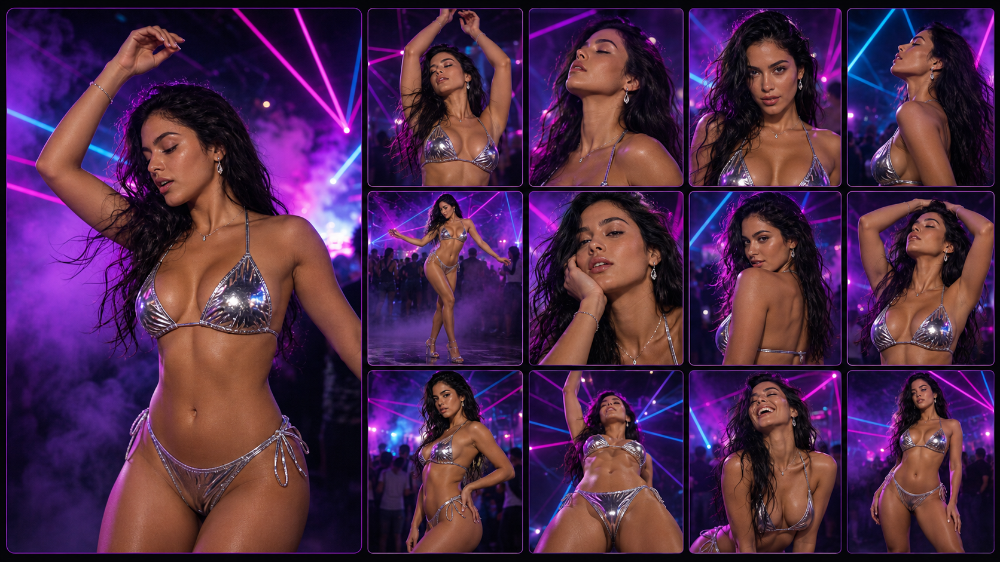
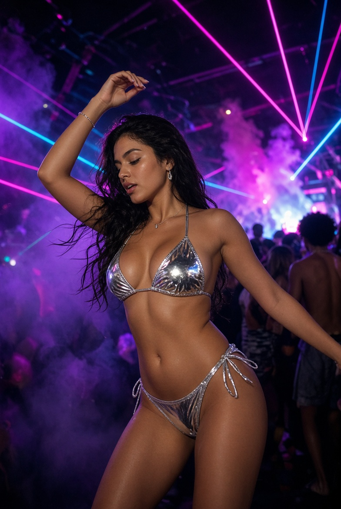
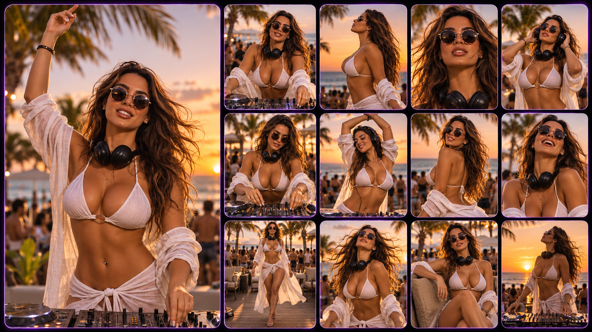

<div align="center">

# TikTok Archetype Testing Framework

**Data-driven selection of visual archetype × music combinations for short-form video performance**

[](#results)
[](#production)
[](#)

</div>

---

## What This Is

A systematic A/B testing framework for short-form video content. The core thesis: **different audience segments respond strongly to specific visual + audio pairs**. By isolating variables (archetype × music × motion style), we can measure what actually drives retention and conversion — not what looks good in preview.

This is not a content dump. It is an evolving experimental log.

---

## Archetype System

Six visual archetypes under test. Each is defined by body presentation, outfit material, setting, lighting, and facial energy — all variables that affect watch-time independently of content quality.

| # | Name | Outfit Material | Setting | Energy | Status |
|:--|:-----|:----------------|:--------|:-------|:-------|
| 1 | **Soft Curvy – Dark Glamour** | Black sequin, latex | Gangster club, BMW, cash | Hypnotic, controlled | 🟢 Active |
| 2 | **Soft Curvy – Metallic Club** | Silver / purple / red metallic | Stage, DJ booth, colored lights | Performance, hypnotic | 🟢 Active |
| 3 | **Beach Sunset DJ** | White micro bikini, open shirt | Beach party, golden hour | Free, warm, physical | 🟡 Early |
| 4 | **Poolside Editorial** | Red micro bikini | Luxury pool, magazine lighting | Static, high-impact | 🟡 Early |
| 5 | **Braided / Luxury** | Velvet, metallic | Luxury lounge, gold accents | Attitude, direct | 🔵 Planned |
| 6 | **Anime-Kawaii (Control)** | Pink, school-skirt | Soft pastel | Cute, different segment | ⚪ Control |

> **Current focus:** Archetypes 1, 2, 3 — highest retention hypothesis based on motion compatibility with dark hypnotic techno and bass-boosted tracks.

---

## Archetype Cards

Detailed specs for each active archetype. See [`/archetypes`](archetypes/README.md) for full definitions.

### Archetype 1 — Soft Curvy, Dark Glamour

> *Highest retention candidate. Luxury club setting with status props reinforces the "aspirational + hypnotic" loop.*

<div align="center">



*12-angle reference sheet — black sequin dress, luxury club, purple/gold lighting*

</div>

<table>
<tr>
<td width="50%">

**Visual Spec**
- Body: Soft hourglass — large breasts, wide hips, soft midsection
- Face: Calm / slightly arrogant, strong direct eye contact
- Hair: Long dark wavy or straight
- Expression sequence: brief corner smile → immediate poker face

**Color Palette**

| Role | Color | Hex |
|:-----|:------|:----|
| Dress | Black sequin | `#0a0a0a` |
| Lighting | Purple neon | `#8b2fc9` |
| Accent | Gold | `#c9a84c` |
| Setting | Dark club | `#141414` |

</td>
<td width="50%">

**Setting Props**
- Stacks of cash on table
- Open Dom Perignon bottles
- Black caviar in crystal bowl
- Black BMW in background
- Neon purple / gold rim lighting

**Music Pairs (highest performing)**
- Dark hypnotic techno
- Slow bass-heavy trap
- Cinematic dark ambient

</td>
</tr>
</table>

---

### Archetype 2 — Soft Curvy, Metallic Club

<div align="center">



*12-angle reference sheet — consistent character identity across all shots*

</div>

<div align="center">



</div>

<table>
<tr>
<td width="50%">

**Visual Spec**
- Same body type as Archetype 1
- Outfit: Shiny metallic micro bikini / bodysuit
- Variants: Silver · Purple · Red
- Setting: Stage or DJ booth

**Color Palette — Silver Variant**

| Role | Color | Hex |
|:-----|:------|:----|
| Outfit | Silver metallic | `#c0c0c0` |
| Lighting | Blue-white stage | `#4a9eff` |
| Background | Dark stage | `#0d0d0d` |
| Accent | Chrome reflection | `#e8e8e8` |

</td>
<td width="50%">

**Color Palette — Purple Variant**

| Role | Color | Hex |
|:-----|:------|:----|
| Outfit | Deep purple metallic | `#6a0dad` |
| Lighting | Violet stage | `#9b30ff` |
| Background | Dark stage | `#0d0d0d` |
| Accent | Pink rim | `#ff69b4` |

**Music Pairs**
- Hyper Car Bass Boosted
- Club techno with strong 4/4 kick
- Purple-tinted electronic

</td>
</tr>
</table>

---

### Archetype 3 — Beach Sunset DJ

<div align="center">



*12-angle reference sheet — white bikini + open shirt, golden hour, beach crowd*

</div>

<table>
<tr>
<td width="50%">

**Visual Spec**
- Body: Soft athletic-curvy, defined waist
- Outfit: White micro bikini + open white shirt, headphones, sunglasses
- Setting: Beach party, DJ decks, golden hour
- Energy: Freer and warmer than club archetypes

**Color Palette**

| Role | Color | Hex |
|:-----|:------|:----|
| Outfit | White | `#f5f5f0` |
| Sky | Golden sunset | `#ff8c42` |
| Accent | Warm coral | `#ff6b6b` |
| Sand | Warm beige | `#d4a76a` |

</td>
<td width="50%">

**Setting Props**
- DJ decks / CDJs
- Palm trees
- Crowd in background
- Warm sunset back-lighting

**Music Pairs**
- Tropical house
- Melodic techno at sunset tempo
- Deep house with vocal chops

</td>
</tr>
</table>

---

## Production System

### Image Generation

All character images generated with strict consistency parameters to maintain archetype identity across frames.

**Core parameters (all archetypes):**
```
photorealistic · 8k detail · cinematic lighting · 9:16 vertical
soft hourglass · large full breasts · wide hips · [not overweight]
calm/arrogant expression · strong direct eye contact
[specific outfit] · [specific setting with props]
```

Full prompt collection → [`/prompts/image-prompts/collection.md`](prompts/image-prompts/collection.md)

---

### Video Animation

**Locked camera protocol** (non-negotiable for all animations):

```
Locked static camera, completely fixed, no zoom, no push-in,
no Ken Burns, no still-image enlargement, no camera movement.
```

The locked camera is the single most important technical parameter. Any camera movement breaks the hypnotic loop effect and reduces average watch time.

**Motion spec:**
- Smooth continuous go-go dance — hip rolls, isolations, full-body waves
- 8–13 seconds optimized for seamless loop
- Expression sequence: brief corner smile → calm arrogant poker face
- Hands: on own body only (waist, hips) — never toward camera

Full master prompt → [`/prompts/master-video-prompt.md`](prompts/master-video-prompt.md)

---

### Technical Standards

| Parameter | Spec | Reason |
|:----------|:-----|:-------|
| Duration | 8–13 sec | Optimal for loop + TikTok retention algorithm |
| Format | 9:16 vertical | Native mobile, no letterboxing |
| Camera | Locked static | Hypnotic effect, no distraction |
| Motion | Continuous fluid | No freezes = no drop-off point |
| Expression | Calm arrogant | Higher profile-visit conversion vs. smiling |
| Hands | On own body | Keeps eye contact unbroken |

---

## Testing Methodology

See [`/docs/methodology.md`](docs/methodology.md) for full protocol.

**Controlled variables (one changed per test):**

```
Archetype  ×  Music mood  ×  Music energy  ×  Caption language
```

**Primary metrics tracked:**

| Metric | Target | Why |
|:-------|:-------|:----|
| Average watch time % | > 80% | Core TikTok ranking signal |
| Loop rate | > 2× | Indicates hypnotic effect working |
| Profile visits / 1K views | > 15 | Conversion intent signal |
| Share rate | > 3% | Viral amplification |

Full metrics spec → [`/docs/metrics.md`](docs/metrics.md)

---

## Video Tool Comparison — Archetype 2 Silver

Same character, same prompt, three different AI video generators. Side-by-side comparison to evaluate output quality, motion fidelity, and loop consistency.

**Base prompt used:** Master locked-camera go-go prompt (see [`/prompts/master-video-prompt.md`](prompts/master-video-prompt.md))  
**Character:** Archetype 2 — Soft Curvy, Silver Metallic, Club setting  
**Duration:** 8 seconds each

| Tool | File size | Loop quality | Motion fidelity | Notes |
|:-----|:----------|:-------------|:----------------|:------|
| **Kling AI** | 6.5 MB | Testing | Testing | Standard generation |
| **Pippit AI** | 3.6 MB | Testing | Testing | Standard generation |
| **Wan Video (Omni)** | 0.8 MB | Testing | Testing | Smallest output |

**Downloads:**
- [kling.mp4](assets/video-comparison/kling.mp4) — Kling AI output
- [pippit.mp4](assets/video-comparison/pippit.mp4) — Pippit AI output
- [wan.mp4](assets/video-comparison/wan.mp4) — Wan Video Omni output

> *GitHub does not auto-play video in README. Download files to compare, or view via raw links above.*

---

## Results

*Living section — updated as experiments complete.*

| Rank | Archetype | Music | Watch Time | Loop Rate | Profile Visits | Status |
|:-----|:----------|:------|:-----------|:----------|:---------------|:-------|
| 1 | Soft Curvy + Dark Glamour | Dark hypnotic techno | — | — | — | 🟢 Active |
| 2 | Soft Curvy + Metallic | Hyper Car Bass Boosted | — | — | — | 🟢 Active |
| 3 | Beach Sunset DJ | Warm tropical house | — | — | — | 🟡 Early |
| — | Anime-Kawaii | Upbeat cute | — | — | — | ⚪ Control |

> Results populate as experiments complete. Log template → [`/experiments/template-experiment.md`](experiments/template-experiment.md)

---

## Repository Structure

```
tiktok-archetype-portfolio/
├── README.md                          ← system overview (this file)
├── archetypes/
│   └── README.md                      ← full archetype specs with reference images
├── prompts/
│   ├── master-video-prompt.md         ← locked camera animation base prompt
│   ├── image-prompts/
│   │   └── collection.md              ← all image generation prompts by archetype
│   └── video-prompts/
│       └── captions-examples.md       ← multilingual captions + hashtags
├── docs/
│   ├── methodology.md                 ← A/B testing protocol
│   └── metrics.md                     ← KPI definitions and measurement approach
├── experiments/
│   └── template-experiment.md         ← log template per test run
├── analytics/                         ← results data (populated as tests run)
└── assets/                            ← reference frames, archetype images, examples
```

---

## Tools Stack

| Stage | Tool | Notes |
|:------|:-----|:------|
| Image generation | Midjourney · Leonardo AI | High-detail photorealistic |
| Video animation | Kling AI · Pippit AI · Runway | Locked camera protocol |
| Editing | CapCut · Adobe Premiere | Loop optimization |
| Script & prompts | Claude AI | Structured prompt engineering |
| Analytics | TikTok Creator Studio | Watch time, loop rate, profile visits |

---

<div align="center">

**Kirill Brüggemann**  
[github.com/KiBrueg](https://github.com/KiBrueg) · [linkedin.com/in/kirill-bruggemann](https://linkedin.com/in/kirill-bruggemann)

*All generated characters are AI-created adults. Project purpose: performance marketing research and portfolio demonstration.*

</div>
